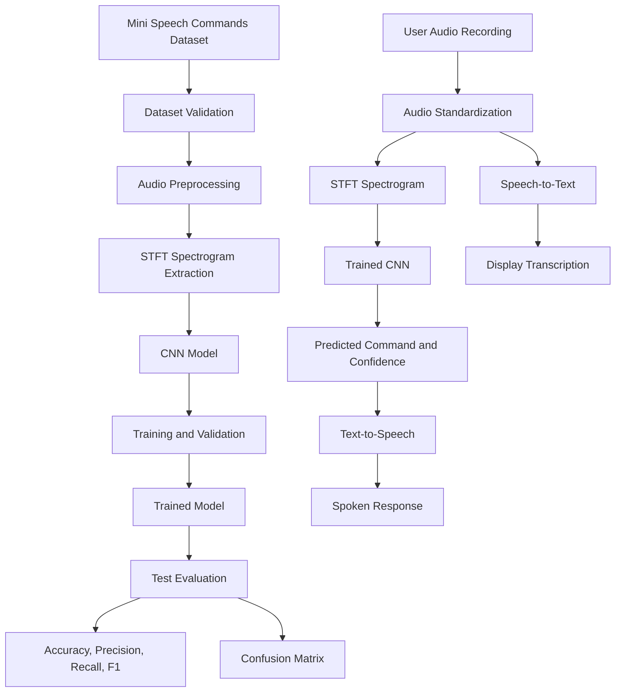
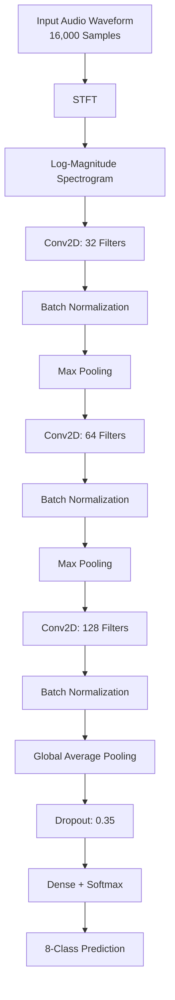

# 🎙️ Deep Learning-Based Audio Classification with Speech-to-Text & Text-to-Speech

<p align="center">

**An intelligent voice-processing application powered by Convolutional Neural Networks (CNNs), TensorFlow, Speech Recognition, and Speech Synthesis.**

</p>

<p align="center">


</p>

## 📌 Overview

This project implements a deep learning-based audio classification system that recognizes spoken commands and integrates **Speech-to-Text (STT)** and **Text-to-Speech (TTS)** capabilities into a unified pipeline.

The application processes audio recordings, extracts time-frequency features using the Short-Time Fourier Transform (STFT), and classifies spoken commands using a Convolutional Neural Network (CNN).

In addition to classification, the application transcribes speech into text and generates an audible response corresponding to the predicted command.

The model is trained on the **Mini Speech Commands dataset**, which contains eight spoken-command categories.

### ✨ Key Features

- 🎧 **Audio preprocessing:** Converts recordings into standardized mono audio at 16 kHz.
- 📊 **Spectrogram extraction:** Transforms audio waveforms into time-frequency representations using STFT.
- 🧠 **CNN-based classification:** Learns acoustic patterns and predicts the spoken-command category.
- 🗣️ **Speech-to-Text:** Converts speech into readable text using the SpeechRecognition library.
- 🔊 **Text-to-Speech:** Generates spoken responses using gTTS.
- 📈 **Model evaluation:** Calculates accuracy, macro-precision, macro-recall, macro-F1-score, and confusion matrix.
- 💾 **Model persistence:** Saves the trained model for subsequent inference.
- 📉 **Training visualization:** Displays training and validation accuracy and loss.

## 🏗️ System Architecture

The system consists of two main stages: **model training and evaluation**, followed by **user-audio inference**.



### 🔄 End-to-End Workflow

1. Download and validate the labeled audio dataset.
2. Split the dataset into training, validation, and testing subsets.
3. Standardize audio recordings and generate spectrograms.
4. Train the CNN using labeled spectrograms.
5. Evaluate the model using the independent test subset.
6. Accept an audio recording from the user.
7. Generate a text transcription using STT.
8. Classify the recording using the trained CNN.
9. Display the transcription and predicted command.
10. Generate and play a spoken response using TTS.

## 🧠 Deep Learning Model Architecture

The project uses a **Convolutional Neural Network (CNN)** to classify spectrograms extracted from spoken audio.

CNNs are effective for this task because convolutional filters learn local acoustic patterns across time and frequency.

### Model pipeline



### Layer configuration

| Layer | Configuration | Purpose |
|---|---|---|
| Input | Spectrogram | Accepts audio features |
| Convolution 1 | 32 filters, 3 × 3 | Learns low-level acoustic patterns |
| Batch normalization | After convolution | Stabilizes training |
| Max pooling | 2 × 2 | Reduces spatial dimensions |
| Convolution 2 | 64 filters, 3 × 3 | Learns intermediate features |
| Batch normalization | After convolution | Improves optimization |
| Max pooling | 2 × 2 | Reduces computational cost |
| Convolution 3 | 128 filters, 3 × 3 | Learns higher-level features |
| Global average pooling | Feature aggregation | Reduces parameters |
| Dropout | 0.35 | Helps reduce overfitting |
| Dense output | 8 neurons, softmax | Predicts the command category |

**Training configuration**

- Optimizer: Adam
- Learning rate: 0.001
- Loss function: Sparse categorical cross-entropy
- Batch size: 64
- Maximum epochs: 20
- Early stopping: Monitors validation loss
- Model checkpointing: Saves the best validation model

## 📂 Dataset

The application uses the [Mini Speech Commands dataset](https://storage.googleapis.com/download.tensorflow.org/data/mini_speech_commands.zip), derived from the Google Speech Commands collection.

The model recognizes eight spoken-command categories:

| Class | Class | Class | Class |
|---|---|---|---|
| `down` | `go` | `left` | `no` |
| `right` | `stop` | `up` | `yes` |

### Dataset preparation

Each recording is:

- Converted to mono audio.
- Resampled to 16,000 Hz.
- Padded or truncated to one second.
- Converted into a log-magnitude spectrogram.
- Associated with its corresponding class label.

The implementation divides the dataset into:

| Subset | Percentage | Purpose |
|---|---:|---|
| Training | 70% | Learn model parameters |
| Validation | 15% | Monitor generalization and select the best model |
| Testing | 15% | Evaluate final classification performance |

The split is performed independently within each class.

## 🗣️ Speech-to-Text (STT)

The STT module uses the `SpeechRecognition` Python library with Google's online speech recognition interface.

### Processing steps

1. Read the user's WAV recording.
2. Pass the audio to the recognition service.
3. Obtain the recognized text.
4. Display the transcription.

Example:

```text
Input audio: "Stop"

STT transcription: "Stop"
```

STT is a separate component from the CNN classifier. It transcribes speech, while the CNN predicts one of the eight supported command categories.

**Requirement:** An internet connection is required for the online recognition service.

## 🔊 Text-to-Speech (TTS)

The TTS module uses Google's Text-to-Speech (`gTTS`) library to convert generated text into an MP3 audio response.

Example:

```text
Predicted command: stop

Generated response:
"The detected command is stop."
```

The generated MP3 can be played directly in the notebook.

**Requirement:** The gTTS service requires internet access.

## 📊 Model Evaluation

The trained CNN is evaluated on the held-out test dataset.

### Evaluation metrics

| Metric | Description |
|---|---|
| Accuracy | Percentage of correctly classified examples |
| Macro-Precision | Average precision across all classes |
| Macro-Recall | Average recall across all classes |
| Macro-F1-score | Average F1-score across all classes |
| Confusion Matrix | Shows correct predictions and misclassifications |
| Training Time | Time required to train the model |

### Results

Replace the placeholders below with the actual values printed by your notebook.

| Metric | Measured result |
|---|---|
| Test accuracy | `Insert actual result` |
| Macro-precision | `Insert actual result` |
| Macro-recall | `Insert actual result` |
| Macro-F1-score | `Insert actual result` |
| Training time | `Insert actual result` |

### Visualizations

The notebook generates the following evaluation artifacts:

- `training_curves.png` — training and validation accuracy and loss.
- `confusion_matrix.png` — class-wise prediction performance.
- `evaluation_results.csv` — numerical evaluation metrics.

These visualizations help identify overfitting, assess generalization, and understand which spoken commands the model confuses.

## 🛠️ Technology Stack

| Technology | Role |
|---|---|
| Python | Core programming language |
| TensorFlow / Keras | Deep learning and model training |
| NumPy | Numerical computation |
| Librosa | Audio loading and resampling |
| SpeechRecognition | Speech-to-Text |
| gTTS | Text-to-Speech |
| Scikit-learn | Classification metrics |
| Matplotlib | Training visualization |
| Seaborn | Confusion matrix visualization |
| Google Colab | Execution environment |

## 🚀 Getting Started

### Prerequisites

- A Google account for Google Colab.
- Internet access for dataset downloading, STT, and TTS.
- A short WAV recording for inference.

### Option 1: Run using Google Colab

1. Open [Google Colab](https://colab.research.google.com/).
2. Create a new Python notebook.
3. Paste the complete implementation into a code cell.
4. Execute the cell.
5. Wait for dataset preparation, model training, and evaluation.
6. Upload a WAV recording when prompted.
7. View the transcription, predicted class, confidence, and generated spoken response.

The complete notebook implementation includes dependency installation, data preparation, training, evaluation, inference, and model saving.

### Option 2: Run locally

Clone the repository:

Create and activate a virtual environment:

```bash
python -m venv venv
```

Windows:

```bash
venv\Scripts\activate
```

Linux/macOS:

```bash
source venv/bin/activate
```

Install dependencies:

```bash
pip install tensorflow librosa numpy pandas matplotlib seaborn scikit-learn SpeechRecognition gTTS
```

Run your notebook using Jupyter or execute the Python implementation after adapting the Colab-specific upload and audio playback sections.

> **Note:** The supplied implementation is designed for Google Colab. Local execution requires adapting `google.colab.files`, notebook audio playback, and file paths.


The dataset is downloaded automatically at runtime and is not required to be committed to the repository.

## 🔬 Limitations

- The classifier recognizes only the eight classes used during training.
- Background noise and unfamiliar accents may reduce accuracy.
- The CNN processes only one second of audio, so longer recordings may be truncated.
- The classifier may assign an unsupported word or sound to one of the known classes.
- STT and TTS require external services and an internet connection.
- Softmax confidence is not a calibrated measure of the probability that a prediction is correct.

## 🔮 Future Enhancements

- Add more command categories and environmental sound classes.
- Implement noise augmentation and more robust audio preprocessing.
- Compare CNN performance with recurrent neural networks and pretrained audio models.
- Use log-Mel spectrograms or learned audio embeddings.
- Integrate offline STT and TTS models.
- Develop a Streamlit or Flask web application.
- Add real-time microphone input and streaming classification.
- Implement a rejection threshold for unsupported or uncertain commands.
- Evaluate STT using Word Error Rate (WER) and TTS using latency and speech-quality measures.

## 🎯 Applications

- Voice-controlled devices.
- Smart-home command interfaces.
- Assistive technology.
- Robotics and hands-free control.
- Educational speech applications.
- Voice-enabled human-computer interaction.

## 📚 References

1. Warden, P. (2018). *Speech Commands: A Dataset for Limited-Vocabulary Speech Recognition.* https://arxiv.org/abs/1804.03209
2. TensorFlow. *Simple audio recognition: Recognizing keywords.* https://www.tensorflow.org/tutorials/audio/simple_audio
3. TensorFlow API. *Audio dataset loading.* https://www.tensorflow.org/api_docs/python/tf/keras/utils/audio_dataset_from_directory
4. SpeechRecognition. https://pypi.org/project/SpeechRecognition/
5. gTTS documentation. https://gtts.readthedocs.io/

## 👨‍💻 Author

**Sarthak Anil Patkar**


---

<p align="center">

**Built with Python, Deep Learning, and Speech AI.**

</p>
